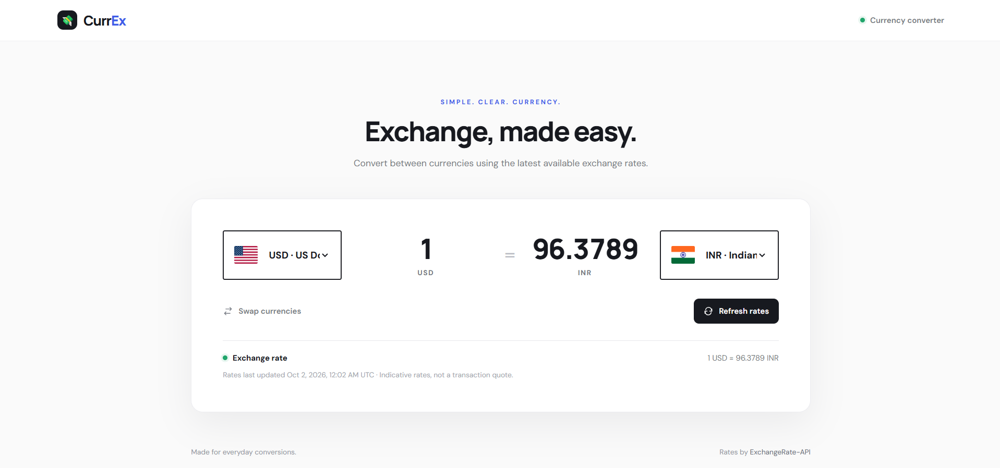

# CurrEx 💱

CurrEx is a clean, responsive currency converter built with HTML, CSS, and vanilla JavaScript. It converts between popular world currencies using the latest available exchange-rate data.

## Features

- Convert between 50 currencies
- Currency selectors with country flags
- Amount updates instantly when you type
- Swap currencies with one click
- Refresh exchange rates
- Responsive layout for desktop and mobile
- No API key or backend required

## Screenshot

## Run locally

1. Download or clone this repository.
2. Open `source/index.html` in your browser.
3. Keep an internet connection available for exchange rates and flags.

## APIs used

- **ExchangeRate-API Open Access:** `https://open.er-api.com/v6/latest/USD`  no API key required. Rates are updated daily, so they are the latest available rates rather than tick-by-tick market prices.
- **FlagCDN:** `https://flagcdn.com/` free country flag images.

Exchange-rate attribution: [ExchangeRate-API](https://www.exchangerate-api.com/). Flags: [FlagCDN](https://flagcdn.com/).

## Tech stack

HTML5 · CSS3 · JavaScript · Fetch API

